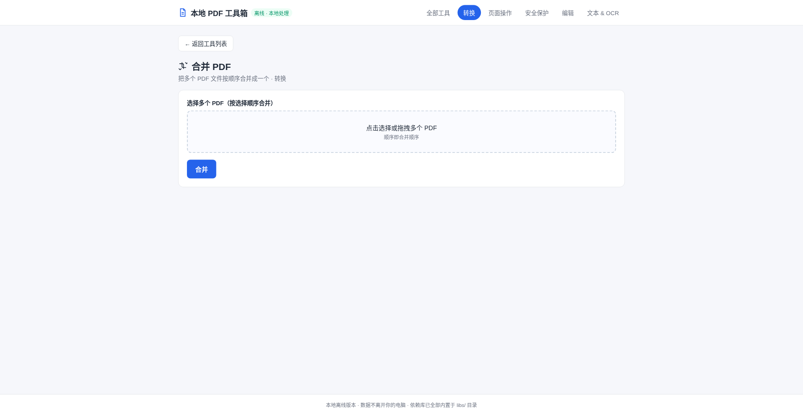
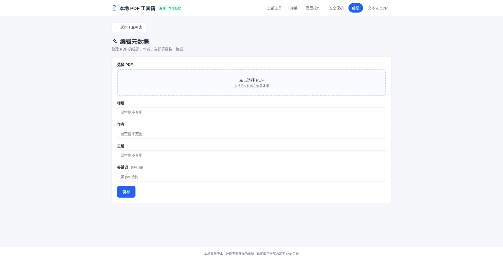
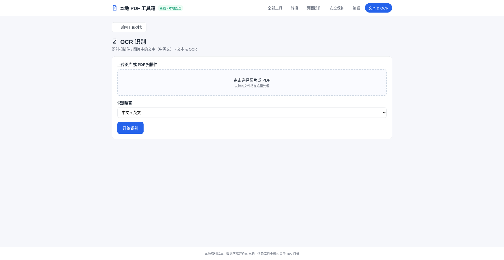

# 本地 PDF 工具箱

一个**完全离线、数据不离开本机**的 PDF 处理工具。所有 PDF 处理库和 OCR 识别模型都内置在 `libs/` 目录里，**不需要联网**，也不需要安装任何额外的软件包（只需电脑有 Node.js 或 Python 之一）。

## 在线 Demo

**▶️ [在线使用 Demo](https://zzw3675.github.io/local-pdf-toolkit/)**

Demo 是完整可用的版本（通过 GitHub Pages 托管）：所有 PDF 处理和 OCR 都在浏览器本地完成，无需安装，打开链接即可直接使用全部 26 个工具。

> 若公司内网屏蔽外网域名，可在本地运行：下载本仓库后双击 `start.bat`，通过 `http://127.0.0.1:8642/` 访问（完全离线，不走外网）。

## 怎么启动

### Windows
双击 **`start.bat`**，会自动打开浏览器并访问 `http://127.0.0.1:8642/`。

### macOS / Linux
双击 **`start.command`**（若提示权限，先在终端执行 `chmod +x start.command`），或用终端运行 `sh start.command`。

### 手动启动（可选）
在文件夹内打开终端，任选其一：
- `node server.js`
- 或 `python3 -m http.server 8642 --bind 127.0.0.1`

然后浏览器访问 `http://127.0.0.1:8642/`。

> 默认端口是 **8642**，如被占用可改：`PORT=9000 node server.js` 或 `python3 -m http.server 9000 --bind 127.0.0.1`，再用对应端口访问。

## 功能清单（共 26 个工具）

**转换**
- 合并 PDF（多文件按顺序合并）
- 拆分 PDF（按页码范围拆成多个文件）
- PDF 转图片（PNG / JPG，可调清晰度）
- 图片转 PDF（多图合并）
- 压缩 PDF（重写结构减少体积）
- PDF 转 HTML（导出网页文本）

**页面操作**
- 旋转页面（90° / 180° / 270°）
- 提取页面（导出指定页）
- 删除页面
- 页面排序（自定义顺序重排）
- 添加空白页（指定位置 / 数量 / 纸张）
- 裁剪页面（四边按比例裁剪）
- 调整页面大小（A4 / Letter / 自定义）
- 添加页码（位置 / 起始数 / 字号 / 颜色）
- 移除空白页（自动检测）
- 拆分对开页（横向页拆成左右两页）
- 多页排版（2 / 4 / 6 合一）
- 叠加 PDF（把一个 PDF 叠加到另一份上）

**安全保护**
- 添加文字水印（中文 / 字号 / 透明度 / 颜色 / 角度）

> 说明：PDF 的"加密 / 去密码 / 数字签名 / 遮黑"等功能在纯浏览器离线环境下无法实现（浏览器端缺少对应库），因此本工具未包含。如需这些功能，可部署到 Docker/NAS 环境的服务器版（如原版 Stirling-PDF）。

**编辑**
- 编辑元数据（标题 / 作者 / 主题 / 关键词）
- 获取 PDF 信息（页数 / 属性 / 时间）
- 添加图片到页面（位置 / 尺寸）
- 添加印章（图片印章叠加到每页）
- 扁平化表单（表单字段压平为静态内容）

**文本 & OCR**
- 提取文本（PDF 内可编辑文本）
- OCR 识别（扫描件 / 图片中的中英文文字）

## 界面截图

首页（工具总览）：


合并 PDF：



编辑元数据：



OCR 识别：



## 隐私说明
- 所有处理都在浏览器本地完成，**文件不会上传到任何服务器**。
- 完全离线可用（依赖库全部在本地 `libs/`）。
- OCR 首次使用需要加载内置的中英文模型（几十 MB 本地文件），会稍慢，属正常现象。

## 目录结构
```
local-pdf-toolkit/
├─ index.html      主界面
├─ app.js          功能逻辑
├─ style.css       样式
├─ server.js       本地启动脚本（Node）
├─ start.bat       Windows 一键启动
├─ start.command   macOS / Linux 一键启动
└─ libs/           内置 PDF / OCR 处理库（离线）
```

## 系统要求
- 任一台支持 **Node.js 18+** 或 **Python 3** 的电脑
- 现代浏览器（Chrome / Edge / Firefox，建议最新版）

## 致谢与说明

- 本项目的**功能清单**参考了开源项目 [Stirling-PDF](https://github.com/Stirling-Tools/Stirling-PDF)（[Apache License 2.0](https://github.com/Stirling-Tools/Stirling-PDF/blob/main/LICENSE)），在此致谢。
- 本项目为**独立的纯前端实现**：使用 pdf-lib / pdf.js / tesseract.js 在浏览器本地完成处理，与 Stirling-PDF 的 Java 后端实现属于两套完全不同的代码与架构，未复制其代码。
- 部分功能（如 PDF 加密 / 数字签名 / 遮黑 / Office 文档互转）需要服务器端能力，纯浏览器环境下无法实现，如需可部署原版 Stirling-PDF 到 Docker/NAS 环境。
